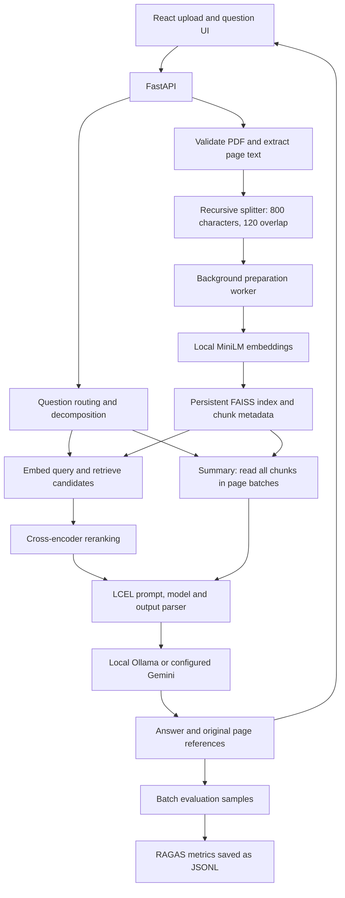

# PolicyLens AI

**Phase 1, Domain 6: HR Policy Bot.** Upload an employee handbook, ask about leave, benefits or conduct rules, and check answers against the cited PDF pages.

**Local inference requires Ollama and the `qwen3:4b-instruct` model.** Embeddings and reranking also run locally. Submission uses Option B: GitHub repository only. Run the app locally using the instructions below.

Repository: https://github.com/narendrasapare/policy-lens-ai

## Scope

This project answers questions over one or a few text-based HR policy PDFs. It demonstrates local embeddings, persistent FAISS retrieval, LCEL chains, query routing/decomposition, cross-encoder reranking and RAGAS evaluation. It does not provide legal advice or answer from external web knowledge. OCR, GraphRAG, hybrid search, SQL tools and multi-agent workflows are outside this Phase 1 build.

The included public `sample-documents/opengov_hr_manual.pdf` has 10 pages. Its working hours, leave, insurance, expense and conduct sections support the evaluation dataset. It is an example handbook, not a statement of Newton School or any user's employment policies.

## Setup

Tested on Windows with Python 3.13 and Node.js 22.17. Use Node.js 22.12 or newer. Install Ollama separately, start it, then run:

```powershell
ollama pull qwen3:4b-instruct
cd backend
python -m venv .venv
.\.venv\Scripts\python.exe -m pip install -r requirements.txt
Copy-Item .env.example .env
cd ../frontend
npm ci
Copy-Item .env.example .env.local
cd ..
```

Keep existing environment files if you have already configured the app. Default inference uses no cloud API key. Embedding and reranker weights download on first use; initial setup time depends on the network and machine. Direct Python dependency versions are pinned and frontend installs use `package-lock.json`. Transitive Python dependencies are not fully locked.

Start the backend and frontend in separate terminals from the project root:

```powershell
powershell -ExecutionPolicy Bypass -File ./scripts/start-backend.ps1
```

```powershell
powershell -ExecutionPolicy Bypass -File ./scripts/start-frontend.ps1
```

Open http://127.0.0.1:5173. API documentation: http://127.0.0.1:8000/docs. Run one API worker/replica because the index uses an in-process lock.

The equivalent direct commands are:

```powershell
# Terminal 1, from backend/
.\.venv\Scripts\python.exe -m uvicorn policylens.main:app --host 127.0.0.1 --port 8000 --workers 1
```

```powershell
# Terminal 2, from frontend/
npm run dev
```

If PowerShell selects a broken npm installation, use the `npm.cmd` from your Node.js installation. If an endpoint reports that generation is unavailable, check `ollama list`, confirm the model matches `OLLAMA_MODEL`, and confirm Ollama is running. A healthy `/health` endpoint alone does not establish model readiness.

## Using the app

1. Upload a PDF, up to 10 MB and 100 pages. Scanned images without extractable text are rejected.
2. Preparation happens automatically in the background. Wait for **Ready for questions**; failed preparation has a **Try again** action. A backend restart resumes unfinished documents.
3. Ask a question. Expand the sources to read excerpts or open the cited PDF page.
4. Ask a multipart question to see its question breakdown. Summary requests read every indexed passage in page order and return cited sections; they can take longer than factual questions.

Duplicate uploads reuse existing files and vectors. Questions are independent; include the topic in each question. The workspace searches all uploaded policies together.

Try:

- What is the minimum annual paid vacation employees should take?
- What happens if payday falls on a weekend?
- How many paid vacation days do employees get, and what percentage of insurance premiums does the company pay?
- Summarize the uploaded policies.
- Does the handbook provide a free gym membership?

## Architecture



Factual questions retrieve 15 candidates by default, rerank them and pass the requested top-k passages to generation. Multipart questions retrieve/rerank each part and merge distinct passages. Summary requests bypass similarity selection so later pages are not excluded: each bounded page batch is summarized with its original source numbers, and the sections are concatenated. Summary source scores are unranked placeholders, and `reranking_applied` is false for that route.

The prompt instructs the model to use only supplied text, cite sources, and acknowledge missing information. This is a prompt constraint, not a guarantee of factual correctness.

## Tech stack

| Component | Choice |
| --- | --- |
| Frontend | React 19, TypeScript 6, Vite 8 |
| API | FastAPI 0.143.3, Pydantic settings |
| PDF extraction | PyMuPDF 1.28.2 |
| Splitting | LangChain recursive character splitter |
| Embeddings | `sentence-transformers/all-MiniLM-L6-v2`, local |
| Vector storage | FAISS 1.15.1, normalized vectors and inner product |
| Reranker | `cross-encoder/ms-marco-MiniLM-L6-v2`, local |
| Generation | LangChain LCEL with Ollama `qwen3:4b-instruct`; optional Gemini |
| Evaluation | RAGAS 0.4.3: faithfulness, answer relevancy, context precision |

## API reference

Base URL: `http://127.0.0.1:8000`. Interactive request/response schemas are available at `/docs`.

| Method | Path | Request and behavior |
| --- | --- | --- |
| GET | `/health` | API process health; does not check model readiness |
| POST | `/api/v1/documents` | Multipart field `file`; extracts text and queues preparation; 201 new / 200 duplicate |
| GET | `/api/v1/workspace/documents` | Document summaries, indexed flag, preparation status/error, vector count |
| POST | `/api/v1/workspace/documents/{id}/retry` | Queue preparation again; returns 202 |
| GET | `/api/v1/documents/{id}/file` | Inline original PDF; add `#page=N` in a browser |
| POST | `/api/v1/search` | JSON `query`, `top_k` (1-20); ranked passages and scores |
| POST | `/api/v1/chat` | JSON `question`, `top_k` (1-10, default 5); answer, sources and routing metadata |
| POST | `/api/v1/documents/{id}/index` | Manual indexing for scripts; the UI does not require it |

Example from PowerShell:

```powershell
$body = @{ question = 'What are the leave rules?'; top_k = 5 } | ConvertTo-Json
Invoke-RestMethod http://127.0.0.1:8000/api/v1/chat -Method Post -ContentType 'application/json' -Body $body
```

Each source includes `reference`, `chunk_id`, `document_id`, `filename`, `page_number` and `excerpt`. The answer cites `[reference]`. `top_k` limits retrieval for factual/multipart questions; summaries read all passages. Preparation in progress returns 409 for chat, invalid uploads return 422, and missing model configuration or generation failures return an explicit error. Source excerpts are the supplied evidence, not a claim that every retrieved passage supports every sentence.

## Reranking evidence

Question: **What happens if payday falls on a weekend?** The current index initially put vacation/schedule passages first. Cross-encoder reranking promoted the payroll passage on page 5, which specifies the preceding Friday.

| Passage | FAISS rank | Reranked rank |
| --- | ---: | ---: |
| `2db61897721e42e1a7a8bf93e2d3a368-p5-c2` (page 5) | 3 | 1 |
| `2db61897721e42e1a7a8bf93e2d3a368-p8-c2` (page 8) | 1 | 2 |
| `2db61897721e42e1a7a8bf93e2d3a368-p8-c1` (page 8) | 2 | 3 |

This example was recorded at `2026-10-18T06:40:02.264979+00:00`. Full pre/post scores and candidate order are in [reranking logs](evaluations/logs/rerank_comparisons.jsonl). It demonstrates one useful ranking change, not a general accuracy claim. To reproduce with your indexed sample:

```powershell
cd backend
.\.venv\Scripts\python.exe -m scripts.compare_rankings
```

## Evaluation

The labeled dataset contains 12 questions: 10 factual, one multipart and one unsupported question. All 12 saved responses now have all three RAGAS scores:

| Metric | Mean | Scored cases |
| --- | ---: | ---: |
| Faithfulness | 0.8750 | 12/12 |
| Answer relevancy | 0.8996 | 12/12 |
| Context precision | 0.9167 | 12/12 |

[Per-case results and reproduction commands](docs/EVALUATION.md) include the low scores and evaluation limits. Results come from actual local scoring of saved responses. Completed earlier scores were reused; these are not freshly regenerated answers for every code change. Generator and evaluator both use `qwen3:4b-instruct`, so this is a small self-evaluation rather than independent validation. The unsupported question and multipart case expose limitations in these model-based judgments.

Batch evaluation is separate from ordinary chat. Records include timestamp, question, answer preview, model versions, source pages, metrics and errors. Do not interpret these metrics as production accuracy or probabilities.

## Checks

From `frontend`, run `npm run build` and `npm run lint`. From `backend`:

```powershell
.\.venv\Scripts\python.exe -m pytest tests -q
.\.venv\Scripts\python.exe -m pip check
```

Tests cover PDF validation, duplicates, automatic preparation/recovery, persistent FAISS writes, routing, reranking, cited answers, and summary coverage across later pages. The current local checks passed: 60 backend tests, TypeScript/Vite build, ESLint and `pip check`. Live checks confirmed a multipart answer, an unsupported-question response, PDF page references, duplicate-upload readiness and a summary reading all 33 passages across the sample's 10 pages. The summary took approximately 42 seconds in one warm local run. Controlled tests do not replace live model checks.

## Submission

This project uses **Option B: GitHub repository only**, as permitted by the shared submission guidelines for projects with heavier local infrastructure. No paid hosting or cloud model account is required for the default local setup. The repository can be cloned publicly without authentication.

Submit this link:

https://github.com/narendrasapare/policy-lens-ai

The evaluated code is the main branch at submission time. Keep keys and private uploads out of the repository and its history. Local setup requires Ollama, the configured model and the Python/Node dependencies described above; first-time downloads depend on the network and machine. A fresh-machine setup including uncached model downloads has not been timed against the 15-minute guideline.

[Hosting instructions](docs/DEPLOYMENT.md) are optional future work and are not required for this repo-only submission.

## Project layout

```text
backend/             FastAPI application, tests and evaluation scripts
frontend/            React application and Vercel configuration
evaluations/         Labeled questions, saved answers, scores and ranking logs
sample-documents/    Public handbook used for the demo and evaluation
scripts/             Local startup helpers and evaluation report generator
docs/                Deployment instructions and detailed evaluation results
```

Local `.env` files, virtual environments, dependencies, uploads, indexes and build output are excluded from the source submission by `.gitignore`. The sample PDF and evaluation records are included for reproducibility.

## Current limits

One shared workspace, independent questions, text-based PDFs, no authentication or per-user document isolation. The index must run with one worker and persistent storage. Longer handbooks produce longer page-grouped summaries and may require more model time. Use public/example policies for a shared demonstration. Cloud generation is available only when deliberately configured; keys stay on the backend.
